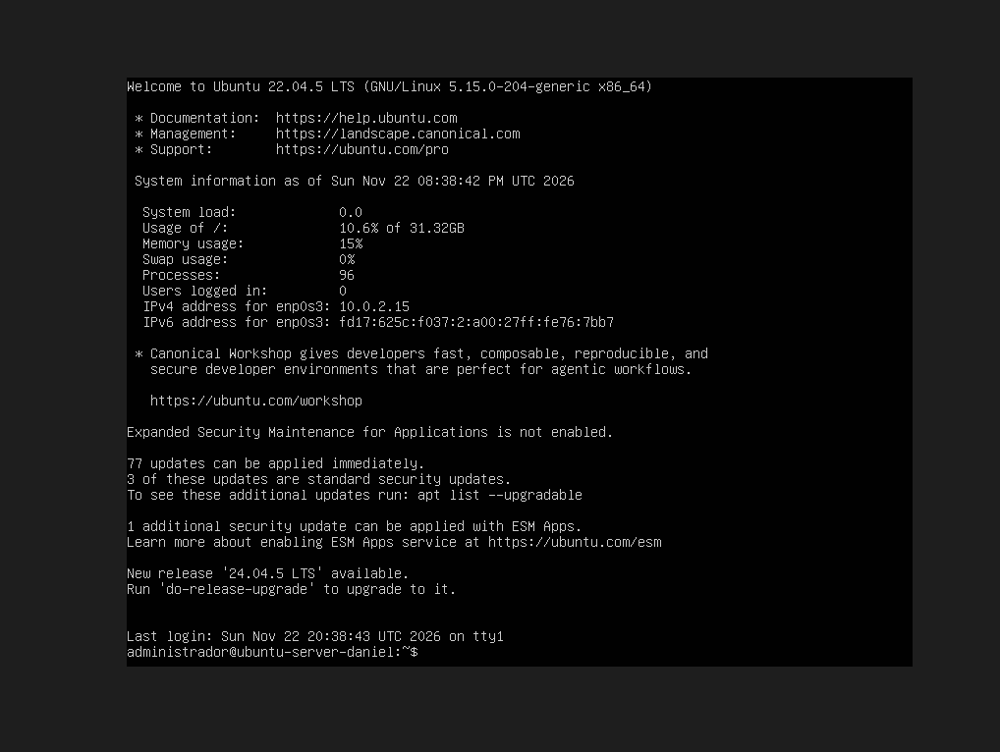

# Atividade - Aula 01: Instalação e Configuração do Ubuntu Server

## 1. Identificação

- **Nome completo:** `Daniel Menezes Nascimento`
- **Matrícula:** `2024327064`
- **Turma:** Técnico em Desenvolvimento de Sistemas 2026.02
- **Data:** 22/11/2026
- **Título:** Instalação e configuração básica de uma VM Ubuntu Server no VirtualBox

## 2. Objetivo

Criar e configurar uma máquina virtual com Ubuntu Server, particionar o disco, criar o usuário administrativo padrão e validar a rede e o serviço SSH.

## 3. Ambiente

- **Sistema do ambiente disponível:** Ubuntu Server 24.04.5 LTS
- **Hipervisor:** Oracle VirtualBox
- **Nome da VM:** `ubuntu-server`
- **Memória:** 768 MB
- **Processador:** 1 CPU
- **Disco:** 32 GB VDI, alocação dinâmica
- **Usuário administrativo:** `administrador`
- **Rede inicial:** NAT

## 4. Procedimento

### 4.1 Tela de login

Após o reinício da instalação, a VM apresentou o nome do sistema e a tela de login.

```text
ubuntu-server login:
```



O login foi feito com o usuário `administrador` e a senha configurada no servidor.

### 4.2 Informações do sistema

```bash
whoami
hostname
hostnamectl
```


Os comandos confirmaram o usuário ativo e o nome da máquina configurado.

### 4.3 Interface e endereço IP

```bash
ip -4 addr
ip route
```


A saída foi usada para identificar a interface virtual, o endereço IPv4 e o gateway fornecido pelo VirtualBox.

### 4.4 Disco e particionamento

```bash
df -h
lsblk
lsblk -f
sudo pvs
sudo vgs
sudo lvs
```


A configuração utiliza `/boot` fora do LVM e os volumes lógicos `ubuntu-lv` e `swap-lv` dentro do grupo `ubuntu-vg`.

### 4.5 Atualização e OpenSSH

```bash
sudo apt-get update
sudo apt-get install -y net-tools traceroute openssh-server
sudo systemctl status ssh --no-pager
dpkg -l | grep openssh-server
```


O serviço SSH foi instalado e ficou ativo.

### 4.6 Configuração da VM no VirtualBox


As configurações da VM correspondem ao padrão da prática: 768 MB de RAM, um processador virtual, disco VDI de 32 GB com alocação dinâmica e adaptador em NAT.

## 5. Testes e evidências

```bash
sudo systemctl is-active ssh
ip -4 addr show
df -h /
```


Os testes confirmaram o sistema ativo, o endereço de rede da VM, o disco disponível e o serviço SSH em execução.

## 6. Problemas e soluções

Durante a preparação foi necessário aguardar a instalação concluir e confirmar o reboot. A VM iniciou normalmente após o reinício e apresentou a tela de login esperada.

Também foi observado que o sistema instalado no ambiente foi Ubuntu Server 24.04.5 LTS, enquanto o roteiro mencionava Ubuntu Server 26.04. Os comandos utilizados correspondem às versões disponíveis e às práticas da aula.

## 7. Conclusão

A VM foi criada e configurada com sucesso. Foi possível identificar o usuário, o hostname, a interface de rede, o particionamento e o estado do SSH. O ambiente ficou preparado para as próximas práticas.
