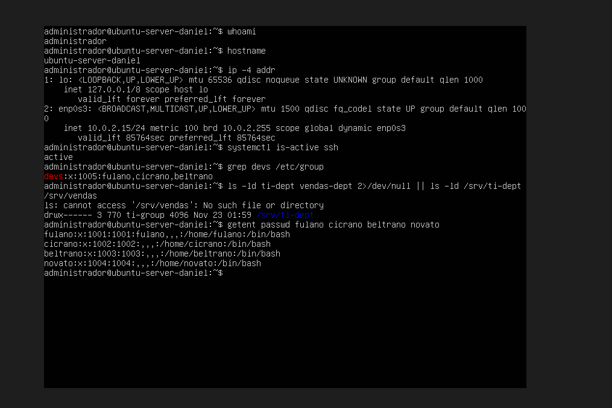

# Atividade - Aula 02: Usuários, Grupos e Permissões

## 1. Identificação

- **Nome completo:** `Daniel Menezes Nascimento`
- **Matrícula:** `2024327064`
- **Turma:** Técnico em Desenvolvimento de Sistemas 2026.02
- **Data:** 22/11/2026
- **Título:** Administração de usuários, grupos e permissões no Linux

## 2. Objetivo

Criar contas de usuários, organizar uma equipe em grupo e aplicar permissões no diretório `/srv/projeto`, permitindo acesso aos membros do grupo e bloqueando usuários externos.

## 3. Ambiente

- Máquina virtual `ubuntu-server`
- Usuário administrativo `administrador`
- Diretório compartilhado `/srv/projeto`
- Grupo de trabalho `devs`
- Ubuntu Server disponível no laboratório

## 4. Procedimento

### 4.1 Criação dos usuários

```bash
sudo adduser fulano
sudo adduser cicrano
sudo adduser beltrano
sudo adduser novato
```

Os usuários foram criados com o padrão de senha usado nos testes da prática.



Para verificar as contas:

```bash
tail -n 5 /etc/passwd
getent passwd fulano cicrano beltrano novato
ls -l /home
```


### 4.2 Criação e associação ao grupo

```bash
sudo groupadd devs
sudo usermod -aG devs fulano
sudo usermod -aG devs cicrano
sudo usermod -aG devs beltrano
grep devs /etc/group
id fulano
id cicrano
id beltrano
id novato
```


O `grep` mostrou os usuários associados ao grupo `devs`. O usuário `novato` não foi incluído.

### 4.3 Propriedade da pasta

```bash
sudo mkdir -p /srv/projeto
ls -ld /srv/projeto
sudo chown administrador /srv/projeto
sudo chgrp devs /srv/projeto
```


### 4.4 Aplicação das permissões

```bash
sudo chmod 770 /srv/projeto
ls -ld /srv/projeto
```


A máscara `drwxrwx---` concede controle ao dono e ao grupo `devs`, enquanto os outros usuários não recebem qualquer acesso.

### 4.5 Arquivo de teste

```bash
echo "Especificacao tecnica do roteador de borda" | sudo tee /srv/projeto/config_redes.txt
sudo chown administrador:devs /srv/projeto/config_redes.txt
sudo chmod 660 /srv/projeto/config_redes.txt
ls -l /srv/projeto
```


O arquivo ficou com a máscara `-rw-rw----`, permitindo leitura e escrita ao dono e ao grupo.

## 5. Testes e validação

### Teste A: usuário do grupo

```bash
su - fulano
cd /srv/projeto
touch arquivo_fulano.txt
ls -l
exit
```


O usuário `fulano` entrou na pasta e criou um arquivo porque pertence ao grupo `devs`.

### Teste B: usuário externo

```bash
su - novato
cd /srv/projeto
ls -l /srv/projeto
exit
```


Os comandos exibiram `Permission denied`, confirmando o isolamento do diretório.

## 6. Problemas e soluções

Quando os grupos forem alterados, é necessário iniciar uma nova sessão com `su - usuario`. Sessões já abertas continuam com os grupos carregados no momento do login.

## 7. Conclusão

Os usuários foram criados e organizados no grupo `devs`. O diretório `/srv/projeto` foi configurado com permissões `770`, e o arquivo de teste recebeu `660`. Os testes confirmaram que um integrante do grupo consegue acessar a pasta e que `novato` recebe `Permission denied`.

## Explicação dos comandos

| Comando | Função |
|---|---|
| `adduser` | Cria uma conta e seu diretório pessoal |
| `groupadd` | Cria um grupo |
| `usermod -aG` | Adiciona o usuário a um grupo suplementar |
| `mkdir -p` | Cria diretórios e os níveis necessários |
| `chown` | Define o usuário proprietário |
| `chgrp` | Define o grupo proprietário |
| `chmod 770` | Autoriza leitura, escrita e acesso ao dono e grupo |
| `chmod 660` | Autoriza leitura e escrita ao dono e grupo |
| `su -` | Inicia uma sessão completa de outro usuário |
