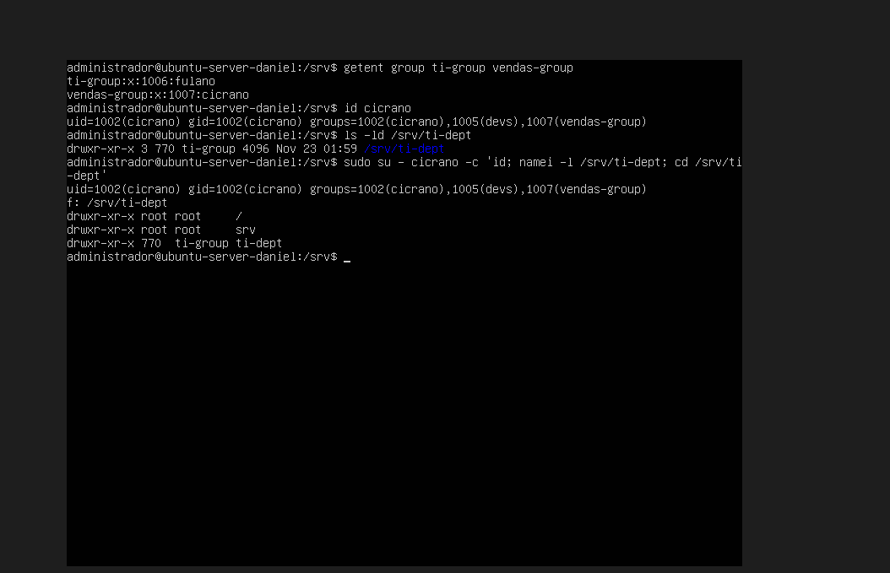

# Atividade - Aula 05: Estrutura de Diretórios e Pastas Departamentais

## 1. Identificação

- **Nome completo:** `Daniel Menezes Nascimento`
- **Matrícula:** `2024327064`
- **Turma:** Técnico em Desenvolvimento de Sistemas 2026.02
- **Data:** 22/11/2026
- **Título:** Estrutura FHS e isolamento de pastas departamentais no Linux

## 2. Objetivo

Explorar o padrão FHS, criar diretórios departamentais, definir grupos e proprietários e validar o isolamento de acesso com os usuários `fulano`, `cicrano` e `novato`.

## 3. Ambiente

- VM `ubuntu-server`
- Usuário administrativo `administrador`
- Pasta `/srv/ti-dept`
- Pasta `/srv/vendas-dept`
- Grupos `ti-group` e `vendas-group`
- Usuários `fulano`, `cicrano`, `beltrano` e `novato`

## 4. Procedimento

### 4.1 Exploração das pastas principais

```bash
cd /
ls
ls -ld /bin /sbin
cd /etc
pwd
ls -F | head -n 15
sudo tail -n 10 /var/log/auth.log
```


A saída confirmou que `/bin` e `/sbin` são links para diretórios dentro de `/usr`. O diretório `/etc` concentra configurações e `/var/log` contém registros do sistema.

### 4.2 Criação das pastas departamentais

```bash
cd /srv
sudo mkdir -p ti-dept/projetos vendas-dept/relatorios
ls -R
```


O `mkdir -p` criou a pasta principal e suas subpastas em uma única operação.

### 4.3 Criação dos grupos

```bash
sudo groupadd ti-group
sudo groupadd vendas-group
sudo usermod -aG ti-group fulano
sudo usermod -aG vendas-group cicrano
id fulano
id cicrano
id novato
```


`fulano` ficou associado ao `ti-group`, `cicrano` ao `vendas-group` e `novato` não pertenceu aos grupos departamentais.

### 4.4 Proprietários e permissões

Inicialmente as pastas pertenciam ao usuário e ao grupo `root`.

```bash
sudo chown -R administrador:ti-group ti-dept
sudo chown -R administrador:vendas-group vendas-dept
sudo chmod -R 770 ti-dept vendas-dept
ls -ld ti-dept vendas-dept
ls -l ti-dept vendas-dept
```


As pastas passaram a usar a máscara `drwxrwx---`, permitindo acesso total ao dono e ao grupo correspondente e bloqueando os demais.

### 4.5 Arquivo confidencial

```bash
sudo touch ti-dept/projetos/arquitetura_rede.txt
sudo chown administrador:ti-group ti-dept/projetos/arquitetura_rede.txt
sudo chmod 660 ti-dept/projetos/arquitetura_rede.txt
ls -l ti-dept/projetos
```


O arquivo ficou com `-rw-rw----`, permitindo leitura e escrita ao dono e ao grupo `ti-group`.

## 5. Testes de isolamento

### Teste A: usuário de TI

```bash
su - fulano
cd /srv/ti-dept
ls -l projetos
cat projetos/arquitetura_rede.txt
exit
```


O usuário `fulano` conseguiu entrar na pasta por pertencer ao `ti-group`.

### Teste B: usuário do departamento de vendas

```bash
su - cicrano
cd /srv/ti-dept
exit
```


O acesso à pasta de TI deve apresentar `Permission denied`, pois `cicrano` pertence ao `vendas-group`, não ao `ti-group`. A verificação deve ser feita em uma nova sessão com `su -`.

### Teste C: usuário sem departamento

```bash
su - novato
cd /srv/ti-dept
cd /srv/vendas-dept
exit
```


O usuário `novato` recebeu `Permission denied` nas duas pastas departamentais.

## 6. Problemas e soluções

Durante os testes foi necessário iniciar novas sessões após adicionar usuários aos grupos. Os grupos suplementares são carregados no momento do login. Por isso foi usado `su - usuario` em vez de `su usuario`.

Foi aplicado também um diagnóstico de grupos e permissões:

```bash
id cicrano
ls -ld /srv/ti-dept
getent group ti-group vendas-group
```



## 7. Conclusão

A árvore de diretórios foi criada com o padrão FHS, os grupos foram associados aos usuários e as permissões foram aplicadas às pastas departamentais. Os testes separaram o acesso permitido ao usuário de TI do acesso negado a usuários externos.

## Explicação dos comandos

| Comando | Função |
|---|---|
| `cd /etc` | Entra no diretório de configurações |
| `pwd` | Exibe o diretório atual |
| `ls -F` | Lista itens identificando diretórios |
| `ls -R` | Lista recursivamente |
| `ls -ld` | Exibe propriedades de diretórios |
| `tail -n 10 /var/log/auth.log` | Exibe os últimos registros de autenticação |
| `mkdir -p` | Cria diretórios e seus níveis necessários |
| `groupadd` | Cria um grupo |
| `usermod -aG` | Adiciona o usuário a um grupo suplementar |
| `id` | Exibe usuário, UID e grupos |
| `chown -R dono:grupo` | Altera dono e grupo recursivamente |
| `chmod 770` | Define controle total ao dono e grupo |
| `chmod 660` | Define leitura/escrita ao dono e grupo |
| `touch` | Cria um arquivo vazio |
| `su -` | Faz login completo como outro usuário |
